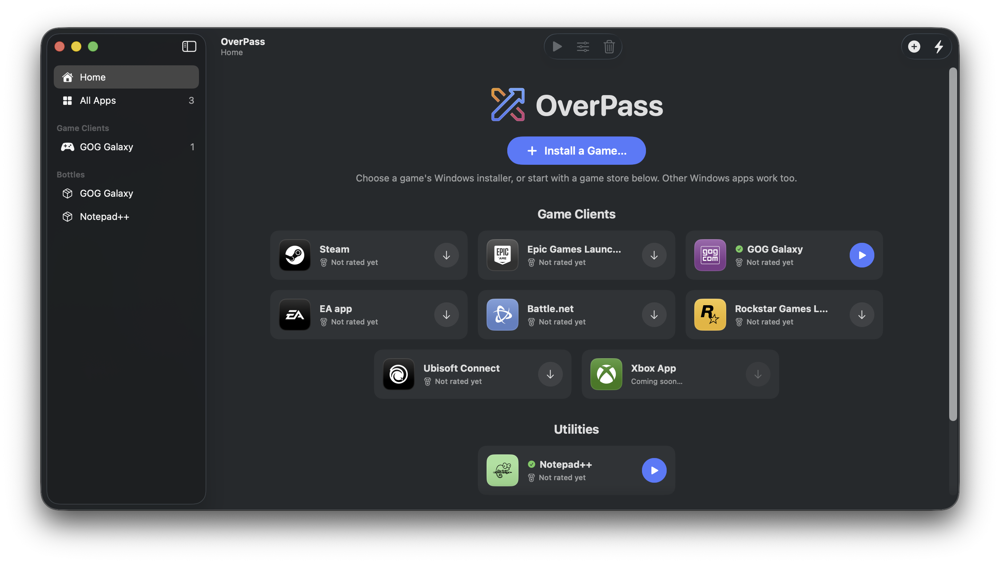
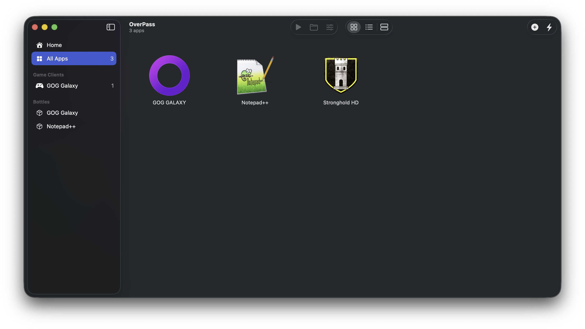
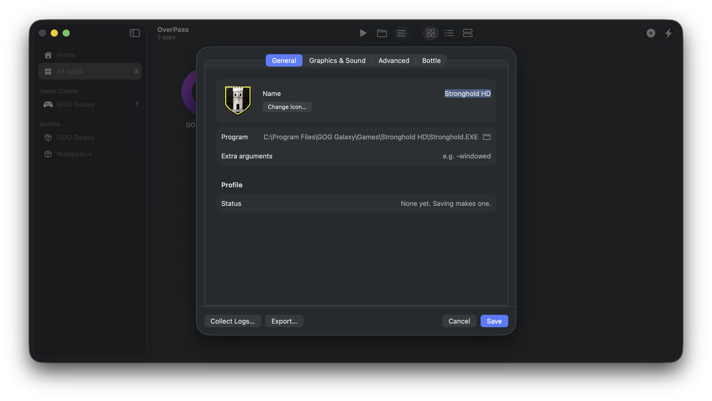

# Screenshots

OverPass in action. More will be added as OverPass grows.

Home lists featured games and launchers. Pick one and click Install:

The library holds everything you have installed, grouped by category:

The profile editor changes a program's Windows version, runtimes, environment, DLL overrides and graphics backend:

